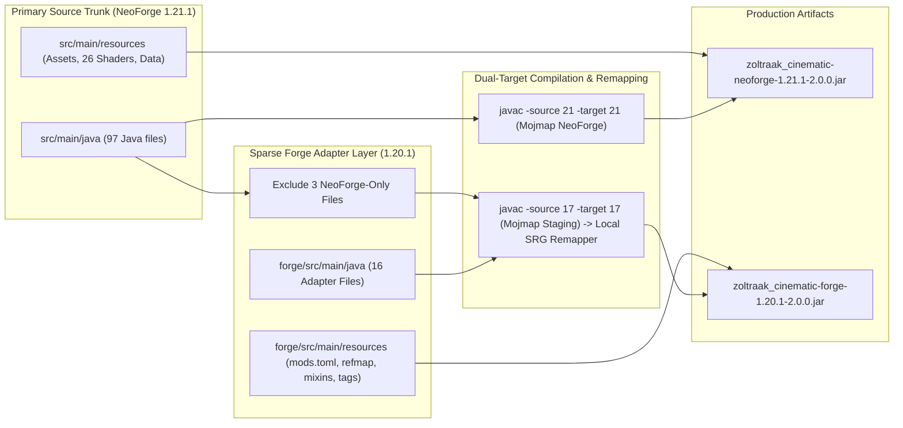
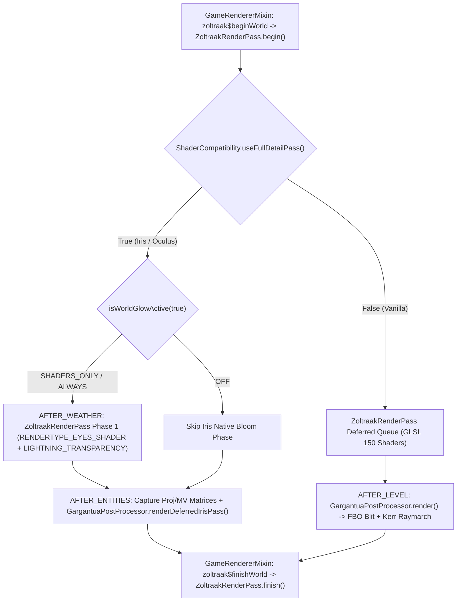

# Zoltraak: Cinematic Edition — Architecture & Technical Documentation

**Version:** 2.0.0 | **Minecraft:** 1.21.1 & 1.20.1 | **Mod Loaders:** NeoForge 21.1.248+ / Forge 47.3.0+ | **Target API:** Iron's Spells 'n Spellbooks

This document provides a comprehensive technical reference for **Zoltraak: Cinematic Edition** (`zoltraak_cinematic`), detailing the dual-loader build pipeline, domain registry, combat & singularity mechanics, Core GLSL 150 shader pipeline, Iris Dual-Pass Emissive Bridge, cinematic camera choreography, real-time configuration UI, and official Sodium 0.8+ integration.

> Related project documentation:
> [README.md](README.md) • [LICENSE](LICENSE) • [NOTICE.txt](NOTICE.txt) • [CREDITS.txt](src/main/resources/assets/zoltraak_cinematic/textures/cosmic/CREDITS.txt)

---

## 1. Executive Summary

**Zoltraak: Cinematic Edition** is a magic, combat, and visual effects mod inspired by *Sousou no Frieren* and *KonoSuba: God's Blessing on This Wonderful World!*, built upon **Iron's Spells 'n Spellbooks**, **GeckoLib**, and **Curios**. Its architecture emphasizes zero external particle-library lock-in, full cross-loader portability, and shader-pack compatibility:

- **Dual-Loader Trunk & Sparse Override Pipeline**: A single Python build orchestrator ([`build_multiloader.py`](build_multiloader.py)) compiles **97** NeoForge 1.21.1 Java classes with JDK 21 (`-source 21 -target 21`), then stages and adapts the trunk alongside **16** Forge 1.20.1 adapter files (**102** compiled classes total, targeting Java 17 bytecode via `-source 17 -target 17`) and remaps them to SRG via `tiny-remapper`.
- **26 Procedural Core GLSL 150 Shaders**: Dedicated fragment/vertex pipelines including a 4-pass `GL_RGBA16F` volumetric black hole & multi-octave HDR bloom chain (`gargantua`, `gargantua_bloom_down`, `gargantua_bloom_up`, `gargantua_composite`), pre-cast spatial horizon previews (`gargantua_disk_preview`, `gargantua_sphere_preview`), Frequency-7 geodesic shields (`defense_barrier`), Qual's accretion corona (`cinematic_singularity_corona`), 24-circle barrage shockwaves (`barrage_fx`, `rapid_zoltraak_bullet`), pyroclastic blast shells (`zoltraak_blast_dome`, `zoltraak_pyroclast`), stylized Explosion Magic pipelines (`explosion_vortex_ring`, `explosion_dome`, `explosion_dust_wave`), optical flares, plumes, and unsealing rituals.
- **Iris Dual-Pass Emissive Bridge & Deferred Sorting**: Zero-overhead vanilla rendering paired with automatic Iris/Oculus detection via [`ShaderCompatibility`](src/main/java/com/frierenflight/zoltraakcinematic/client/renderer/ShaderCompatibility.java), routing emissive spell geometry through `RENDERTYPE_EYES_SHADER` (`AFTER_WEATHER`) before fullscreen lensing capture (`AFTER_ENTITIES`).
- **Keyframe Timeline Camera Rig & Mixins**: Priority-based multi-phase cutscene playback ([`CinematicRigController`](src/main/java/com/frierenflight/zoltraakcinematic/client/cinematic/CinematicRigController.java)) backed by [`CameraMixin`](src/main/java/com/frierenflight/zoltraakcinematic/mixin/CameraMixin.java), [`GameRendererMixin`](src/main/java/com/frierenflight/zoltraakcinematic/mixin/GameRendererMixin.java), and [`PlayerModelPoseMixin`](src/main/java/com/frierenflight/zoltraakcinematic/mixin/PlayerModelPoseMixin.java).
- **Real-Time Studio UI & Official Sodium 0.8+ Integration**: Instant live-preview client tuning via [`ZoltraakConfigScreen`](src/main/java/com/frierenflight/zoltraakcinematic/client/gui/ZoltraakConfigScreen.java) (`\` key / Mod screen / Sodium shortcut) and native Sodium Video Options pages via [`ZoltraakSodiumConfig`](src/main/java/com/frierenflight/zoltraakcinematic/compat/sodium/ZoltraakSodiumConfig.java).

---

## 2. High-Level System Architecture

```mermaid
flowchart TB
    subgraph Core_And_Config ["Core Initializer & Dual-Tier Configuration"]
        ModEntry["ZoltraakCinematicMod / ZoltraakCinematicForgeMod"]
        CommonCfg["ZoltraakCinematicConfig (COMMON: 8 Sections)"]
        ClientCfg["ZoltraakCinematicClientConfig (CLIENT: 4 Sections)"]
        PlatformSPI["Services / IPlatformHelper (SPI)"]
        ModEntry --> CommonCfg
        ModEntry --> ClientCfg
        ModEntry --> PlatformSPI
    end

    subgraph Domain_And_Registries ["Domain & Deferred Registries"]
        Schools["ModCinematicSchools (ordinary_magic, black_hole) + Fire School"]
        Attributes["ModCinematicAttributes (4 Player Magic Attributes)"]
        Spells["ModCinematicSpells (8 Registered Spells)"]
        Items["ModCinematicItems (11 Items, Staves, Curios, Scrolls)"]
        Entities["ModCinematicEntities (6 Entities)"]
        BlocksFx["ModCinematicBlocks & ModCinematicMobEffects & Sounds (15)"]
    end

    subgraph Combat_And_Entities ["Entities, Boss AI & Event Interception"]
        BeamEnt["ZoltraakCinematicBeamEntity"]
        BarrageEnt["ZoltraakBarrageProjectileEntity"]
        BarrierEnt["DefenseBarrierEntity & GeodesicDomeData (Freq-7)"]
        GargantuaEnt["GargantuaEntity (Kerr Singularity & Debris)"]
        ExplosionEnt["ExplosionMagicEntity & ExplosionDamage"]
        QualBoss["QualBossEntity (4-Goal AI + QualSealingStone)"]
        CombatEvents["DefenseEvents, FlightEvents, ZoltraakDamage"]
    end

    subgraph Cinematic_And_Mixins ["Cinematic Camera & Client Mixins"]
        Director["CinematicRigController & Cutscenes"]
        ScreenFx["GargantuaScreenFx & GargantuaShake"]
        Mixins["CameraMixin, GameRendererMixin, PlayerModelPoseMixin"]
        Mixins --> Director
        Mixins --> ScreenFx
    end

    subgraph Rendering_Pipeline ["Client Rendering & Shader Pipeline"]
        RenderPass["ZoltraakRenderPass (Deferred Queue + AFTER_WEATHER)"]
        ShaderComp["ShaderCompatibility (Iris / Oculus Hook)"]
        GargPost["GargantuaPostProcessor (FBO Ping-Pong & Raymarch)"]
        PreviewRend["GargantuaPreviewRenderer & CosmicTextures"]
        EntityRend["Beam, Array (24-Circle), Barrier, Explosion, Qual & Ritual Renderers"]
        Shaders["26 Core GLSL 150 Shaders (.json / .vsh / .fsh)"]
        RenderPass --> ShaderComp
        GargPost --> ShaderComp
        GargPost --> PreviewRend
        RenderPass --> EntityRend
        EntityRend --> Shaders
        GargPost --> Shaders
    end

    subgraph UI_And_Compat ["Config UI & Sodium Integration"]
        StudioUI["ZoltraakConfigScreen (5 Tabs, Real-Time Spec)"]
        SodiumAPI["ZoltraakSodiumConfig (sodium:config_api_user, 0x33C0FF)"]
        SodiumAPI --> StudioUI
        SodiumAPI --> ClientCfg
        StudioUI --> ClientCfg
    end

    subgraph Networking_Layer ["Client-Server Synchronization"]
        NFNet["ModCinematicNetworking (CustomPacketPayload)"]
        FGNet["ForgeNetworkHandler (SimpleChannel)"]
        Payloads["DefenseCastPayload & FlightTogglePayload"]
        NFNet --> Payloads
        FGNet --> Payloads
    end

    ModEntry --> Domain_And_Registries
    Spells --> Combat_And_Entities
    PlatformSPI --> Networking_Layer
    ClientCfg --> Rendering_Pipeline
    ClientCfg --> Cinematic_And_Mixins
```



---

## 3. Multi-Loader Build & Compatibility Architecture

**Zoltraak: Cinematic Edition** targets both **NeoForge 1.21.1** and **Forge 1.20.1** from a single repository without Gradle workspace duplication. Orchestration is driven by [`build_multiloader.py`](build_multiloader.py).



### 3.1 Code Sharing & Staging Mechanics

- **Primary Trunk (`src/main/java`)**: Contains **97** Java source files written against Mojang mappings for NeoForge 1.21.1.
- **Exclusion Filter on Forge Staging**: When staging Forge 1.20.1, `build_multiloader.py` excludes **3** NeoForge-specific files (`NeoForgePlatformHelper.java`, `ModCinematicNetworking.java`, and `ZoltraakSodiumConfig.java`), leaving **94** trunk files before Forge override substitution.
- **Sparse Adapter Layer (`forge/src/main/java` & `forge/src/main/resources`)**: Contains **16** Forge 1.20.1 Java files covering `ZoltraakCinematicForgeMod`, `ForgePlatformHelper`, `ForgeNetworkHandler` (`SimpleChannel` packets), Forge event adapters, block/item 1.20.1 signatures, and Forge mixin variants (`forge/mixin/*`). **8** of these override identical relative trunk paths (`ZoltraakCinematicMod`, `QualSealingStoneBlock`, `QualSealingStoneBlockEntity`, `DefenseEvents`, `FlightEvents`, `FrierenStaffItem`, `DefenseCastPayload`, `FlightTogglePayload`), alongside Forge resources (`META-INF/mods.toml`, `pack.mcmeta`, `zoltraak_cinematic.forge.mixins.json`, `zoltraak_cinematic.forge.refmap.json`, and 1.20.1 tags).
- **Verified Reuse Breakdown**:
  - **86** files from `src/main/java` are adapted cleanly (`adapt_common_source_for_forge`) and compiled into the Forge build alongside the **16** Forge-specific/overridden files (**102** compiled Java source files total in Forge staging), representing **84.3%** shared trunk file reuse in the Forge compilation unit (`86 / 102`).
- **Resource & Packaging Adaptation**: During Forge staging, `build_multiloader.py` adapts 1.21+ resource structures into MC 1.20.1 (`pack_format: 15`) layout (`data/zoltraak_cinematic/recipe/*.json` with `result.id` -> `data/zoltraak_cinematic/recipes/*.json` with `result.item`, and `tags/item/` -> `tags/items/`), and passes `MixinConfigs: zoltraak_cinematic.forge.mixins.json` via `--manifest` into `jar --create` prior to SRG remapping.
- **Platform SPI Decoupling (`platform/`)**: Shared gameplay code calls [`Services.PLATFORM`](src/main/java/com/frierenflight/zoltraakcinematic/platform/Services.java) (`IPlatformHelper`), abstracting `getPlatformName`, `isClient`, `isModLoaded`, `getPartParent`, `sendDefenseCastToServer`, `sendFlightToggleToServer`, `syncPlayerMana`, and `applyStaffAttributes` across NeoForge 1.21.1 DataComponents vs Forge 1.20.1 attribute modifiers.

---

## 4. Directory & Package Structure

```text
Zoltraak Cinematic - NeoForge 1.21.1/
├── build_multiloader.py                        # Dual-loader compiler, recipe/tag/SRG adapter, --clean, --deploy & --test/--verify suite
├── ARCHITECTURE.md                             # System architecture & technical specification (v2.0.0)
├── LICENSE                                     # Proprietary All Rights Reserved license with modpack & audio/image grants
├── NOTICE.txt                                  # Clean-room statement, asset inventory, third-party notices & disclaimers
├── README.md                                   # Project overview, feature list, installation, build & usage rights
├── tools/
│   ├── generate_noise_tile.py                  # Procedural 512x512 seamless FBM/Worley/Blue-Noise generator
│   └── generate_qual_assets.py                 # Procedural Qual boss GeckoLib geometry, texture & animation generator
├── forge/                                      # Sparse Forge 1.20.1 adapter layer (16 Java files + Forge resources)
│   └── src/main/
│       ├── java/com/frierenflight/zoltraakcinematic/
│       │   ├── ZoltraakCinematicMod.java       # Forge-adapted shared mod bootstrap
│       │   ├── block/, event/, item/, network/ # 1.20.1 signature adapters
│       │   └── forge/
│       │       ├── ZoltraakCinematicForgeMod.java # Forge @Mod entrypoint & ConfigScreenFactory registration
│       │       ├── mixin/                      # Forge 1.20.1 Mixin variants (3 files)
│       │       ├── network/                    # SimpleChannel & packet codecs (3 files)
│       │       └── platform/ForgePlatformHelper.java
│       └── resources/                          # mods.toml, pack.mcmeta, forge mixins/refmap, 1.20.1 tags & SPI
└── src/
    ├── main/java/com/frierenflight/zoltraakcinematic/ (97 Java files)
    │   ├── ZoltraakCinematicMod.java           # NeoForge @Mod entrypoint & IConfigScreenFactory registration
    │   ├── ZoltraakDamage.java                 # I-frame bypass & magic resistance damage utility
    │   ├── block/                              # QualSealingStoneBlock & QualSealingStoneBlockEntity
    │   ├── client/
    │   │   ├── QualClientHelper.java
    │   │   ├── ZoltraakCinematicClientEvents.java # Keybindings (X, V, \), audio volume scaling, HUD
    │   │   ├── cinematic/                      # 9-class keyframe timeline rig & spell cutscenes
    │   │   │   ├── CinematicRigController.java / CameraTrack.java
    │   │   │   ├── CameraTransform.java / CameraRigFrame.java / CameraObstacleSolver.java
    │   │   │   ├── ZoltraakCutscenes.java / GargantuaCutscenes.java
    │   │   │   └── GargantuaCasterPose.java / GargantuaScreenFx.java
    │   │   ├── gui/ZoltraakConfigScreen.java   # Real-time 5-tab Studio Config UI
    │   │   ├── model/QualBossModel.java
    │   │   └── renderer/ (27 classes)          # 26-shader registries, Iris bridge, raymarch & entity renderers
    │   │       ├── ZoltraakCinematicShaders.java / ZoltraakRenderTypes.java / ZoltraakRenderPass.java
    │   │       ├── GargantuaPostProcessor.java / GargantuaPreviewRenderer.java / CosmicTextures.java
    │   │       ├── ExplosionChargeRenderer.java / ExplosionMagicRenderer.java / ZoltraakImpactFx.java
    │   │       ├── DefenseBarrierRenderer.java / GeodesicDomeData.java / ShaderCompatibility.java
    │   │       └── Beam, Barrage, Boss, Stone, Shake, ColorTheme & Mode helpers
    │   ├── command/GargantuaCommands.java      # /singularity, /gargantua, /zoltraak gargantua night
    │   ├── compat/sodium/ZoltraakSodiumConfig.java # Official Sodium 0.6+/0.8+ ConfigEntryPoint
    │   ├── config/
    │   │   ├── ZoltraakCinematicConfig.java    # COMMON config (8 sections)
    │   │   └── ZoltraakCinematicClientConfig.java # CLIENT config (4 sections)
    │   ├── effect/FlightMobEffect.java
    │   ├── entity/ (12 classes)
    │   │   ├── DefenseBarrierEntity.java
    │   │   ├── ExplosionDamage.java & ExplosionMagicEntity.java
    │   │   ├── GargantuaDamage.java & GargantuaEntity.java
    │   │   ├── ZoltraakBarrageProjectileEntity.java & ZoltraakCinematicBeamEntity.java
    │   │   └── boss/ (QualBossEntity + ai/ 4 goal classes)
    │   ├── event/ (DefenseEvents.java, FlightEvents.java)
    │   ├── item/ (9 custom item & relic classes)
    │   ├── mixin/ (CameraMixin.java, GameRendererMixin.java, PlayerModelPoseMixin.java)
    │   ├── network/ (ModCinematicNetworking, DefenseCastPayload, FlightTogglePayload)
    │   ├── platform/ (IPlatformHelper, Services, NeoForgePlatformHelper)
    │   ├── registry/ (8 DeferredRegister classes)
    │   └── spell/ (8 AbstractSpell implementations)
    └── main/resources/
        ├── META-INF/neoforge.mods.toml         # Mod manifest + sodium:config_api_user declaration
        └── assets/zoltraak_cinematic/
            ├── shaders/core/                   # 78 files (26 GLSL 150 programs: .json, .vsh, .fsh)
            ├── textures/, models/, sounds/ (15 .ogg), lang/ (en_us.json, th_th.json — 211 keys each)
            └── geo/, animations/               # GeckoLib boss geometry & animations
```

> *Note: Local third-party dependency directories (`libs/`, `libs_forge/`, `tools/remapper/`) and compiled `.jar` outputs are excluded via `.gitignore`, are not part of this source repository, and remain governed by their respective third-party licenses/terms.*

---

## 5. Domain & Registry System

### 5.1 Magic Schools ([`ModCinematicSchools`](src/main/java/com/frierenflight/zoltraakcinematic/registry/ModCinematicSchools.java))

| School ID | Color Theme | Spell Power Attribute | Magic Resist Attribute |
| :--- | :---: | :--- | :--- |
| `zoltraak_cinematic:ordinary_magic` | `#00E5FF` (Cyan) | `zoltraak_spell_power` | `zoltraak_magic_resist` |
| `zoltraak_cinematic:black_hole` | `#8A2BE2` (Violet) | `black_hole_spell_power` | `black_hole_magic_resist` |

*(Additionally, `ExplosionSpell` binds to Iron's Spells 'n Spellbooks' native `irons_spellbooks:fire` school via `SchoolRegistry.FIRE_RESOURCE`.)*

### 5.2 Registered Attributes ([`ModCinematicAttributes`](src/main/java/com/frierenflight/zoltraakcinematic/registry/ModCinematicAttributes.java))

Four syncable `MagicPercentAttribute` traits (default `1.0D`, range `-100.0D` to `100.0D`) are attached to `EntityType.PLAYER`:
- `zoltraak_spell_power` / `zoltraak_magic_resist`
- `black_hole_spell_power` / `black_hole_magic_resist`

### 5.3 Spell Catalog & Balance Architecture ([`ModCinematicSpells`](src/main/java/com/frierenflight/zoltraakcinematic/registry/ModCinematicSpells.java))

| Spell ID | Class | School | Rarity / Max Lvl | Cast Type | Base Mana | Base Power | Cooldown | Tactical Behavior |
| :--- | :--- | :--- | :---: | :---: | :---: | :---: | :---: | :--- |
| `zoltraak` | `ZoltraakCinematicSpell` | `ordinary_magic` | EPIC / 10 | `INSTANT` | `200` (`+6/lvl`) | `80` (`+8/lvl`) | `4.0s` | Standard lance beam; Crouch triggers `ZoltraakMode.LARGE` (Great Zoltraak) with extended range and cutscene. |
| `corrupted_zoltraak` | `CorruptedZoltraakSpell` | `ordinary_magic` | EPIC / 10 | `INSTANT` | `250` (`+7/lvl`) | `100` (`+9/lvl`) | `4.5s` | Theme 1 (`HUMAN_KILLING`) abyssal beam inflicting Wither and armor-piercing damage. |
| `zoltraak_barrage` | `FernBarrageSpell` | `ordinary_magic` | EPIC / 1 | `CONTINUOUS` (`200t`) | `15` (`+2/lvl`) / `0.5s` | `5` (`+7/lvl`) | `1.5s` | Summons a 24-circle celestial array (`BARRAGE_INITIAL_DELAY=8t`, `BARRAGE_FIRE_INTERVAL=10t`) firing homing light lances. |
| `corrupted_barrage` | `CorruptedBarrageSpell` | `ordinary_magic` | EPIC / 1 | `CONTINUOUS` (`80t`) | `20` (`+3/lvl`) / `0.5s` | `7` (`+8/lvl`) | `1.8s` | Capped 4.0s (`80t`) dark-matter rapid barrage (`colorTheme=1`). |
| `defense` | `DefensiveMagicSpell` | `ordinary_magic` | UNCOMMON / 10 | `INSTANT` | `200` (`+10/lvl`) | `150` (`+23/lvl`) | `10.0s` | Deploys directional hex Aegis or Crouch 360° Geodesic Dome; duration scales as `getBarrierDurationTicks() + (lvl-1)*22`. |
| `flight` | `FlightMagicSpell` | `ordinary_magic` | RARE / 5 | `INSTANT` | `25` ignition | `1` (`+1/lvl`) | `1.0s` | Toggles 3D flight (`0` mana to deactivate); continuous drain starts at `max(10.0, base - (lvl-1)*reduction)`. |
| `gargantua` | `GargantuaSpell` | `black_hole` | LEGENDARY / 1 | `LONG` (`80t`) | `300` | `500` | `600.0s` | 4.0s incantation manifests a supermassive Kerr black hole at `computeTargetPosition`. |
| `explosion` | `ExplosionSpell` | `irons_spellbooks:fire` | LEGENDARY / 1 | `LONG` (`70t`) | `300` | `100` (`+20/lvl`) | `120.0s` | 3.5s chant (`72.0` block range) channels stacked sky vortex rings, strikes from the sky zenith, detonates an expanding blast dome & parabolic crater, drains remaining mana to `0`, and applies brief exhaustion. |

### 5.4 Items, Curios & Relics ([`ModCinematicItems`](src/main/java/com/frierenflight/zoltraakcinematic/registry/ModCinematicItems.java))

All **11** registered items are fire-resistant (`fireResistant()`):

1. `frieren_staff` (`FrierenStaffItem`): Epic `StaffItem` with `+45%` Spell Power, `+35%` Zoltraak Spell Power, `+500` Max Mana, `+20%` Cooldown Reduction, plus configurable Cast Time Reduction (`items.staffCastSpeedBonus`, default `+15%`) and Mana Regen (`items.staffManaRegenBonus`, default `5.0`) via `Services.PLATFORM.applyStaffAttributes(...)` on NeoForge and `FrierenStaffItem` on Forge.
2. `ordinary_grimoire` (`OrdinaryGrimoireItem`): 10-slot Epic `SpellBook` (`+30%` Zoltraak Spell Power, `+15%` Spell Power, `+300` Max Mana, `+15%` Cooldown Reduction).
3. `elder_sage_grimoire` (`ElderSageGrimoireItem`): 12-slot Epic `SpellBook` (`+50%` Zoltraak Spell Power, `+20%` Spell Power, `+1000` Max Mana, `+30%` Cooldown Reduction, `+20%` Cast Time Reduction).
4. `mirror_lotus_ring` (`MirrorLotusRingItem`): Ring Curio (`+25%` Zoltraak Spell Power, `+15%` Cooldown Reduction, `+150` Max Mana, `+1.0` Mana Regen).
5. `mana_concealment_pendant` (`ManaConcealmentPendantItem`): Necklace Curio (`+20%` Zoltraak Magic Resist, `+10%` Cast Time Reduction, `+200` Max Mana).
6. `corruption_core` (`CorruptionCoreItem`): Necklace Curio (`+35%` Zoltraak Spell Power, `+350` Max Mana, `+2.5` Mana Regen).
7. `chronos_dilatation_watch` (`ChronosDilatationWatchItem`): Charm Curio (`+15%` Cooldown Reduction, `+35%` Black Hole Spell Power); right-clicking unleashes a Time Dilation Field applying Slowness IV and Mining Fatigue IV (configured via `items.watchRadius`, `items.watchDurationTicks`, `items.watchCooldownSec`).
8. `horn_of_corruption` (`HornOfCorruptionItem`): Rare crafting catalyst dropped by Qual (`stacksTo(16)`).
9. `gargantua_scroll` (`GargantuaScrollItem`): Epic `Scroll` pre-bound via `ISpellContainer` to `gargantua` Level 1 (`stacksTo(16)`).
10. `qual_sealing_stone`: BlockItem for `ModCinematicBlocks.QUAL_SEALING_STONE` (Epic).
11. `qual_spawn_egg`: `DeferredSpawnEggItem` for `ModCinematicEntities.QUAL_BOSS`.

### 5.5 Blocks, Mob Effects & Sound Registry

- **Block (`ModCinematicBlocks`)**: `qual_sealing_stone` ([`QualSealingStoneBlock`](src/main/java/com/frierenflight/zoltraakcinematic/block/QualSealingStoneBlock.java)) — indestructible (`strength(-1.0f, 3600000.0f)`), light level `6`, hosts `QualSealingStoneBlockEntity` for the 5.0-second Unsealing Ritual.
- **Mob Effect (`ModCinematicMobEffects`)**: `flight` (`FlightMobEffect`, `BENEFICIAL`, color `#38D6F5`).
- **Sound Events (`ModCinematicSounds` — 15 sounds)**: `zoltraak_charge`, `zoltraak_fire`, `zoltraak_impact`, `zoltraak_great_fire`, `qual_spawn`, `qual_ambient`, `qual_hurt`, `qual_death`, `qual_phase_transition`, `qual_cataclysmic_charge`, `qual_teleport`, `singularity_charge`, `singularity_active`, `singularity_explode`, and `tinnitus`.

---

## 6. Entities, Boss System & Combat Mathematics

### 6.1 Damage Bypass & Magic Resistance ([`ZoltraakDamage`](src/main/java/com/frierenflight/zoltraakcinematic/ZoltraakDamage.java), [`GargantuaDamage`](src/main/java/com/frierenflight/zoltraakcinematic/entity/GargantuaDamage.java), [`ExplosionDamage`](src/main/java/com/frierenflight/zoltraakcinematic/entity/ExplosionDamage.java))

- `ZoltraakDamage.apply(...)` multiplies incoming spell damage by `DamageSources.getResist(target, school)` when a `SchoolType` is supplied, and zeroes `target.invulnerableTime` before and after `DamageSources.applyDamage(...)` when `rapid == true` so continuous barrages never suffer i-frame loss or lock out allies.
- `GargantuaDamage.source(...)` resolves the custom `zoltraak_cinematic:gargantua` `DamageType` from registry access with graceful fallback to `magic()`.
- `ExplosionDamage.source(...)` resolves the custom `zoltraak_cinematic:explosion` `DamageType` from registry access with graceful fallback to `explosion(...)`.

### 6.2 `ZoltraakCinematicBeamEntity`

- Synchronized entity with fixed `LIFETIME = 46` ticks (`2.3s`) and `FIRE_TICK = 14` ticks (`0.70s` charge phase).
- Replicates origin vectors (`DATA_ORIGIN_X/Y/Z`), aim vectors (`DATA_DIR_X/Y/Z`), beam length, impact distance/normal, color theme (`0` = Ordinary Cyan, `1` = Corrupted Purple), and `ZoltraakMode` (`NORMAL` / `LARGE`) to drive client GLSL beam & plume shaders and shield-breaking physics.

### 6.3 `ZoltraakBarrageProjectileEntity`

- Guided projectile (`MAX_LIFETIME = 35` entity constant; configurable max flight lifetime via `barrage.lifeTicks`, default `60`) launched sequentially from the **24** celestial coordinates in `FernBarrageSpell.BARRAGE_CIRCLE_OFFSETS` (`Row 1` 5 Crown circles, `Row 2` 4 Upper-Mid circles, `Row 3` 6 Primary Battery wing circles, `Row 4` 4 Lower-Mid circles, `Row 5` 5 Base circles).
- Tracks `DATA_TARGET_ID`, projectile path history for tapered trail geometry (`RapidZoltraakRenderer`), impact normal, and triggers staggered supersonic muzzle rings (`ZoltraakBarrageArrayRenderer.onCircleFired`).

### 6.4 `DefenseBarrierEntity` & Frequency-7 Geodesic Dome

```
                     Incoming Attack Segment (from -> eyeTo / centerTo)
                                        │
                 DefenseEvents (EventPriority.LOW, AABB inflate 4.0)
                                        │
                       barrier.intersection(from, target)
                          ┌─────────────┴─────────────┐
                          ▼                           ▼
               MODE_DIRECTIONAL (0)             MODE_DOME (1)
          BARRIER_RADIUS = 2.8m sphere     DOME_RADIUS = 3.2m sphere
          61 Hex Cells (|q+r| <= 4)       Frequency-7 Goldberg Polyhedron
          CELL_RADIUS = 0.30m              492 Hex/Pent Cells, 1,470 Unique Edges
```

- **Server Interception**: [`DefenseEvents`](src/main/java/com/frierenflight/zoltraakcinematic/event/DefenseEvents.java) intercepts `LivingIncomingDamageEvent`, sorts nearby barriers by distance to source origin, tests geometric ray intersection (`intersection`), and deducts absorbed capacity via `barrier.absorb(amount, contact)` using a fire-immune entity (`isOnFire() == false`).
- **Procedural Frequency-7 Mesh ([`GeodesicDomeData`](src/main/java/com/frierenflight/zoltraakcinematic/client/renderer/GeodesicDomeData.java))**: Class-I Frequency-7 dual Goldberg subdivision (`generateDome(7)`) computes **492** dual cells and **1,470** deduplicated honeycomb edges directly at startup.
- **First-Person Ergonomics**: [`DefenseBarrierRenderer`](src/main/java/com/frierenflight/zoltraakcinematic/client/renderer/DefenseBarrierRenderer.java) respects `visuals.barrierView` (`CENTER_FADE`, `MINIMAL`, `EDGE_ONLY`, `FULL`; accepting legacy aliases `LIGHT` -> `MINIMAL` and `PERIMETER` -> `EDGE_ONLY`) and `visuals.barrierOpacity` (default `0.35`) so full 360° domes remain optically clear around the player's camera sightline (paired with `visuals.circleView` / `visuals.circleOpacity` for magic circles in `ZoltraakRenderPass`).

### 6.5 `QualBossEntity` & 4-Goal Combat AI

- **Base Attributes**: `1500.0` HP (`+200.0` HP per nearby player), Armor `30`, Toughness `10`, Knockback Resist `1.0`, Follow Range `96.0`, Max Mana `6000.0`, Purple `ServerBossEvent` with screen darkening, music, and fog.
- **Hierarchical Goal Stack**:
  1. `QualCataclysmicGoal` (Phase 4, `<20%` HP): `70`-tick (`3.5s`) motionless charge (`COOLDOWN_TICKS = 4000` / `200s`), summoning a `GargantuaEntity` (`BLACK_HOLE_LIFETIME = 400` ticks / `20s`).
  2. `QualAntiBarrierGoal` (Phase 2+): Detects `DefenseBarrierEntity` — executes **Shadow Blink** behind players using `MODE_DIRECTIONAL`, or unleashes concentrated barrage/beam pressure against `MODE_DOME`.
  3. `QualCombatGoal`: Multi-phase spell rotation (`Zoltraak`, `Corrupted Zoltraak`, Barrages).
  4. `QualFollowPlayerGoal`: 3D aerial hover & pursuit.
- **Unsealing Ritual**: Interacting with `QualSealingStoneBlock` initiates a `5.0`-second ritual (`unsealing_magic_circle` & `unsealing_fire_column` shaders) before spawning `QualBossEntity`.

### 6.6 `GargantuaEntity` Relativistic Singularity System

`GargantuaEntity` models a rotating Kerr black hole parameterized with astrophysical ratios (`GRAVITATIONAL_RADIUS = 4.0f` blocks / `r_g`, `HORIZON_RADIUS = 1.8f` `r_g`, photon shadow `SHADOW_RADIUS = 5.196f` `r_g`, ISCO `DISK_INNER_RADIUS = 3.83f` `r_g`, `DISK_OUTER_RADIUS = 13.5f` `r_g`, `SPIN = 0.6f`):

- **Shared Crosshair Target & Cave Protection**: `GargantuaSpell.computeTargetPosition(...)`, `GargantuaSpell.computeSpinAxis(...)`, and `GargantuaEntity.applyGroundClearance(...)` align server spawning and client preview 1:1 while clamping spawn height safely beneath cave or indoor ceilings.
- **Torn Surface Debris & Optional Reconstruction**: Lifts terrain blocks into orbiting accretion debris capped by `gargantua.maxDebrisBlocks` (default `180`). Removed blocks are recorded in `tornBlocksHistory` (`Map<BlockPos, BlockState>`) and restored on collapse via `reconstructSurfaceBlocks()` when `gargantua.reconstructBlocks` is enabled (default `false` for destructive impact).
- **Commands ([`GargantuaCommands`](src/main/java/com/frierenflight/zoltraakcinematic/command/GargantuaCommands.java))**: Permission-2 commands `/singularity`, `/gargantua`, `/gargantua night`, `/zoltraak singularity`, `/zoltraak gargantua`, and `/zoltraak gargantua night`.
- **160m Blast Flash Attenuation**: Supernova flash & camera trauma attenuate smoothly out to `160`–`240` blocks (`GargantuaScreenFx` & `GargantuaShake`).

### 6.7 `ExplosionMagicEntity` Stylized Detonation & Crater System

[`ExplosionSpell`](src/main/java/com/frierenflight/zoltraakcinematic/spell/ExplosionSpell.java) (`CAST_RANGE = 72.0`, `castTime = 70` ticks) spawns [`ExplosionMagicEntity`](src/main/java/com/frierenflight/zoltraakcinematic/entity/ExplosionMagicEntity.java) at the targeted point upon completion:
- **Multi-Stage Incantation & Detonation Visuals**: During casting, [`ExplosionChargeRenderer`](src/main/java/com/frierenflight/zoltraakcinematic/client/renderer/ExplosionChargeRenderer.java) layers swirling ground vortices, cyan fountain ribbons, staff orb bloom, converging suction rays, and a 6-ring sky funnel; upon release, [`ExplosionMagicRenderer`](src/main/java/com/frierenflight/zoltraakcinematic/client/renderer/ExplosionMagicRenderer.java) renders the diagonal trigger beam, apex flare, vertical laser strike, multi-layered fiery/soot detonation dome (`explosion_dome`), rolling dust wave collars (`explosion_dust_wave`), and aftermath embers using `glow.explosion`.
- **Crater Carving & Resource Trade-Offs**: Carves a shallow parabolic bowl crater up to `explosion_magic.explosionRadius` (default `22.0`) and `explosion_magic.explosionCraterDepth` (default `6.0`) with flung `FallingBlockEntity` rock debris when `explosionBreakBlocks` & `mobGriefing` allow, deals scaled blast damage via `ExplosionDamage`, drains remaining non-Creative player mana to `0` (`explosionDrainMana`), and applies brief post-cast exhaustion debuffs (`explosionExhaustionEnabled`).

---

## 7. Client Rendering & Visual Architecture

### 7.1 Deferred Translucent Queue & Iris Dual-Pass Emissive Bridge



- **Far-Plane Horizon Clamping**: Core `.vsh` shaders apply `gl_Position.z = min(gl_Position.z, gl_Position.w * 0.9995);` so cosmic/beam geometry at extreme distances avoids far-plane Z-clipping.
- **Iris Dual-Pass Buffer Flush**: [`ZoltraakRenderTypes`](src/main/java/com/frierenflight/zoltraakcinematic/client/renderer/ZoltraakRenderTypes.java) supplies `IRIS_EMISSIVE_QUAD` and `irisEmissiveTextured(...)` using `DefaultVertexFormat.NEW_ENTITY` + `RENDERTYPE_EYES_SHADER` (`LIGHTNING_TRANSPARENCY` `SRC_ALPHA, ONE`), enabling Complementary/BSL/Solas HDR bloom and reflections without dark square cutout artifacts.
- **Per-Spell Bloom & Emissive Scaling (`0%–200%`)**:
  - **Vanilla / Deferred Pass**: `ZoltraakRenderPass.endBatchWithBloom(...)` wraps draws with `beginBloomColorScale(...)`, keeping `ColorModulator.rgb = max(1.0, scale)` so dimming (`0%–100%`) preserves hue saturation instead of darkening translucent beams, while `100%–200%` drives HDR overbright radiance (`DefenseBarrierRenderer` passes `minAlphaFloor = 0.22F` for `DEFENSE_SURFACE` so shield crystal silhouettes remain visible at `0%`). `GargantuaPostProcessor` scales `DiskShape.w` directly (`max(DiskShape.w, 0.0)` in `gargantua.fsh`).
  - **Iris / Oculus Phase 1**: `ZoltraakRenderPass.renderIrisScaled(...)` multiplies vertex alpha inside `addColorVertex` / `addProxyVertex` across `0%–100%` without modifying packed `Color.rgb` metadata, and executes a second additive emissive pass scaled to `scale - 1.0F` when configured above `100%`.
- **Texture Unit Hygiene**: `GargantuaPostProcessor` saves and restores `GL_TEXTURE0` (`RenderSystem.activeTexture`) across passes so fullscreen post-processing never corrupts subsequent GUI or hand rendering.

### 7.2 Core GLSL 150 Shader Inventory (**26 Programs**)

Registered in [`ZoltraakCinematicShaders`](src/main/java/com/frierenflight/zoltraakcinematic/client/renderer/ZoltraakCinematicShaders.java) (`assets/zoltraak_cinematic/shaders/core/`):

| # | Shader Program ID | Field Name | Vertex Format | Blending (`ZoltraakRenderTypes`) | Primary Architectural Role |
| :-: | :--- | :--- | :--- | :--- | :--- |
| 1 | `cinematic_singularity_corona` | `corona` | `POSITION_TEX_COLOR` | Additive (`ADD`) | Qual's demonic accretion corona (logarithmic inflow spiral, corona streamers & horizon rim) |
| 2 | `cinematic_photon_beam` | `zoltraak` | `POSITION_TEX_COLOR` | Additive (`ADD`) | Standard blue-cyan Zoltraak photonic beam core & Fresnel sheath |
| 3 | `cinematic_abyssal_beam` | `blackZoltraak` | `POSITION_TEX_COLOR` | Translucent | Corrupted `HUMAN_KILLING` dark violet/magenta Zoltraak beam |
| 4 | `cinematic_great_abyssal` | `greatBlack` | `POSITION_TEX_COLOR` | Translucent | Large-scale Corrupted Zoltraak abyssal cannon envelope |
| 5 | `cinematic_great_photon` | `greatWhite` | `POSITION_TEX_COLOR` | Translucent | Charged Great Zoltraak blinding photonic inner spear |
| 6 | `cinematic_plasma_plume` | `greatPlume` | `POSITION_TEX_COLOR` | Translucent | Volumetric plasma plume & shock trail sheath |
| 7 | `magic_circle` | `magicCircle` | `POSITION_TEX_COLOR` | Additive (`ADD`) | Ordinary Magic celestial rune ring projection |
| 8 | `black_magic_circle` | `blackMagicCircle` | `POSITION_TEX_COLOR` | Translucent | Corrupted demonic rune circle geometry |
| 9 | `defense_barrier` | `defenseBarrier` | `POSITION_COLOR` | Translucent | Animated hexagonal refraction lattice for directional & Frequency-7 dome barriers |
| 10 | `unsealing_magic_circle` | `unsealingMagicCircle` | `POSITION_TEX_COLOR` | Additive (`ADD`) | Monolith seal fracture circle during Qual unsealing |
| 11 | `unsealing_fire_column` | `unsealingFireColumn` | `POSITION_TEX_COLOR` | Additive (`ADD`) | Vertical demonic flame pillar during Qual unsealing ritual |
| 12 | `cinematic_flare` | `cinematicFlare` | `POSITION_TEX_COLOR` | Additive / Translucent | Anamorphic horizontal/vertical bloom & optical glint flares |
| 13 | `zoltraak_impact` | `zoltraakImpact` | `POSITION_TEX_COLOR` | Additive / Translucent | Shockwave ripple & surface burn flash at beam impact point |
| 14 | `zoltraak_blast_dome` | `zoltraakBlastDome` | `POSITION_TEX_COLOR_NORMAL` | Additive / Translucent | Volumetric impact blast dome with Fresnel energy rim & crater glow (`ZoltraakImpactFx`) |
| 15 | `zoltraak_pyroclast` | `zoltraakPyroclast` | `POSITION_TEX_COLOR_NORMAL` | Translucent | Layered pyroclastic shock clouds and impact soot shells (`ZoltraakImpactFx`) |
| 16 | `barrage_fx` | `barrageFx` | `POSITION_TEX_COLOR` | Additive (`ADD`) | Sub-atlas transonic compression muzzle shockwave rings for 24-circle barrage |
| 17 | `rapid_zoltraak_bullet` | `rapidBullet` | `POSITION_TEX_COLOR` | Additive / Translucent | Tapered high-velocity barrage light lances & dark thorns |
| 18 | `gargantua` | `gargantua` | `POSITION_TEX` (Screen Quad) | `GL_RGBA16F` HDR Pass 1 | Local-frame volumetric black hole raymarching, curved space lensing & `GasDisc` / `Haze` emission |
| 19 | `gargantua_bloom_down` | `gargantuaBloomDown` | `POSITION_TEX` (Screen Quad) | `GL_RGBA16F` Pass 2 (Mip `0..5`) | 13-tap energy-preserving Karis downsample + Gaussian cross-filter bloom pyramid |
| 20 | `gargantua_bloom_up` | `gargantuaBloomUp` | `POSITION_TEX` (Screen Quad) | `GL_RGBA16F` Pass 3 (Mip `4..0`) | B-spline bicubic + 9-tap tent upsample bloom reconstruction |
| 21 | `gargantua_composite` | `gargantuaComposite` | `POSITION_TEX` (Screen Quad) | Fullscreen Composite Pass 4 | Analytic background lensing, starfield reveal, anamorphic flare & filmic Power-Reinhard tonemapping |
| 22 | `gargantua_disk_preview` | `gargantuaDiskPreview` | `POSITION_TEX_COLOR` | Additive (`ADD`) | Crosshair equatorial disk & ISCO/blast-radius boundary preview (`GargantuaPreviewRenderer`) |
| 23 | `gargantua_sphere_preview` | `gargantuaSpherePreview` | `POSITION_TEX_COLOR_NORMAL` | Additive (`ADD`) | Kerr frame-dragging latitude/longitude silhouette sphere preview (`GargantuaPreviewRenderer`) |
| 24 | `explosion_vortex_ring` | `explosionVortexRing` | `POSITION_TEX_COLOR` | Additive (`ADD`) | Multi-mode sky vortex rings, cyan fountain ribbons, streaks & radial Gaussian blooms |
| 25 | `explosion_dome` | `explosionDome` | `POSITION_TEX_COLOR_NORMAL` | Translucent / Additive | Crimson-gold detonation dome, glowing fissures, outer soot shell & pressure halo |
| 26 | `explosion_dust_wave` | `explosionDustWave` | `POSITION_TEX_COLOR` | Translucent | Rolling ground dust collars, waist cloud torus rings & erupting soot chunks |

All core spell, circle, barrier, impact, and preview shaders support `ColorModulator` uniform scaling for per-spell bloom control, while the Gargantua 4-pass pipeline reads scaled `DiskShape.w` (`clamp(DiskShape.w, 0.0, 2.0)`).

### 7.3 Gargantua Multi-Pass HDR Post-Processor & Astronomical Sky ([`GargantuaPostProcessor`](src/main/java/com/frierenflight/zoltraakcinematic/client/renderer/GargantuaPostProcessor.java), [`CosmicTextures`](src/main/java/com/frierenflight/zoltraakcinematic/client/renderer/CosmicTextures.java))

- **4-Pass `GL_RGBA16F` Pipeline & Ping-Pong Targets**: Renders volumetric black hole HDR radiance into `hdrFbo`, executes a 6-level downsample pyramid (`downFbos[0..5]`) + 5-level bicubic tent upsample pyramid (`upFbos[0..4]`), and composites onto `postTarget` alongside `sceneCopy`, `DepthSampler`, `NoiseSampler` (3D white noise & organic streak channels), and mipmapped/anisotropic `CosmicSampler` (`milky_way.jpg`). Runs seamlessly in both Vanilla (`AFTER_LEVEL`) and Iris/Oculus (`renderDeferredIrisPass()`).
- **Packed Vector Uniform Contract (`gargantua` & `gargantua_composite`)**:
  - `HoleCentre`: `vec4(eyePos.xyz, r_g)`
  - `SpinAxis`: `vec4(spinAxis.xyz, lensingMode)` (`0.0` off, `1.0` lensing, `2.0` lensing + chromatic aberration)
  - `HoleState`: `vec4(opened 0..1, criticality+blast 0..2, wrappedSeconds, swallowedCount)`
  - `DiskShape`: `vec4(worldIlluminationFlag, outerRadiusRg [8..40, default 22.0], raymarchSteps [32|72|96|128] / lensFlares, brightness)`
  - `DiskU`: `vec4(tangentU.xyz, cutsceneWeight)`
  - `InverseProjectionMat` & `InvViewRotMat`: Reconstruct eye-space & galactic rays per pixel.
- **Anti-Banding & Radiance Fidelity**: Uses R2 spatial dithering (`r2Dither`) without temporal ghosting, `pcurve` radial density + 3D noise octaves on `NoiseSampler.b`, seamless 360-degree azimuth blending, localized photon-sphere `Haze`, emission-coupled sky transmittance, B-spline bicubic bloom, Power-Reinhard (`p = 1.5`) + Hermite S-curve + warm channel grading, and supernova shockwave/ray flares.

### 7.4 Cinematic Camera Choreography & Client Mixins (`client/cinematic/*` & `mixin/*`)

- **Keyframe Timeline & Camera Rig (`client/cinematic/*`)**: [`CinematicRigController`](src/main/java/com/frierenflight/zoltraakcinematic/client/cinematic/CinematicRigController.java) orchestrates priority-ordered [`CameraTrack`](src/main/java/com/frierenflight/zoltraakcinematic/client/cinematic/CameraTrack.java) phase timelines, [`CameraTransform`](src/main/java/com/frierenflight/zoltraakcinematic/client/cinematic/CameraTransform.java) shortest-arc Euler interpolation, [`CameraRigFrame`](src/main/java/com/frierenflight/zoltraakcinematic/client/cinematic/CameraRigFrame.java) local basis transforms, and [`CameraObstacleSolver`](src/main/java/com/frierenflight/zoltraakcinematic/client/cinematic/CameraObstacleSolver.java) outdoor/cave collision clearance.
- **Prebuilt Choreography**:
  - [`ZoltraakCutscenes`](src/main/java/com/frierenflight/zoltraakcinematic/client/cinematic/ZoltraakCutscenes.java): 4-phase Great Zoltraak track (`105` ticks, priority `15`).
  - [`GargantuaCutscenes`](src/main/java/com/frierenflight/zoltraakcinematic/client/cinematic/GargantuaCutscenes.java): 5-act journey — `playIncantation` Act 0 dolly pullback (`priority 10`), followed by `playSingularity` Acts 1–4 spanning `280` ticks (`14.0s`: Rupture `0..60t`, 288° Accretion Orbit `60..180t`, High-Altitude Vortex `180..240t`, Handoff `240..280t`, `priority 20`).
- **Client Mixins (NeoForge & Forge Variants)**:
  - `CameraMixin` (`zoltraak$cinematicCamera`): Applies [`CameraTransform`](src/main/java/com/frierenflight/zoltraakcinematic/client/cinematic/CameraTransform.java) position, yaw, pitch, and third-person detach state while a track is active.
  - `GameRendererMixin`: Hooks `renderLevel` (`zoltraak$beginWorld` / `zoltraak$finishWorld`), `bobHurt` (`GargantuaShake.applyHarmonicShake`), `getFov` (`CinematicRigController.blendFov`), and `renderItemInHand` (hides viewmodel hands during cutscenes).
  - `PlayerModelPoseMixin` (`zoltraak$gargantuaPose`): Applies dramatic levitation/incantation arm poses during `GargantuaSpell` casting (`GargantuaCasterPose`).

---

## 8. Networking & Client Controls

### 8.1 Keybindings & Client Events ([`ZoltraakCinematicClientEvents`](src/main/java/com/frierenflight/zoltraakcinematic/client/ZoltraakCinematicClientEvents.java))

| Default Key | Mapping Name | Action |
| :-: | :--- | :--- |
| **`X`** | `KEY_DEFENSE` | Rapidly deploys Directional Aegis (or Crouch for 360° Geodesic Dome) via packet (`DefenseCastPayload`). |
| **`V`** | `KEY_FLIGHT` | Toggles Flight Magic via packet (`FlightTogglePayload`). |
| **`\`** | `KEY_CONFIG` | Opens [`ZoltraakConfigScreen`](src/main/java/com/frierenflight/zoltraakcinematic/client/gui/ZoltraakConfigScreen.java) directly from gameplay (avoids colliding with Iris's default `K` toggle). |
| **`Spacebar`** | Cutscene Skip | Skips active camera director sequences back to manual player control. |

`ZoltraakCinematicClientEvents` and `GargantuaScreenFx` also scale custom spell/boss `SoundInstance` volumes dynamically using `audio.modSoundVolume` (`getModSoundVolume()`) and gate/scale post-detonation tinnitus playback via `audio.earRinging` (`isEarRingingEnabled()`) and `audio.earRingingVolume` (`getEarRingingVolume()`).

### 8.2 Dual-Loader Packet Bridge

- **NeoForge 1.21.1 (`ModCinematicNetworking`)**: Registers `DefenseCastPayload` (`playToServer`) and `FlightTogglePayload` (`playToServer`) via `RegisterPayloadHandlersEvent`.
- **Forge 1.20.1 (`ForgeNetworkHandler`)**: Registers `ForgeDefenseCastPacket` and `ForgeFlightTogglePacket` (delegating server handling to Forge `DefenseCastPayload.handleServer` and `FlightTogglePayload.handleServer`) over `SimpleChannel` (`zoltraak_cinematic:main`, protocol `"1"`).

---

## 9. Configuration Architecture, Real-Time UI & Sodium 0.8+ Integration

### 9.1 Dual-Tier TOML Model

- **Server / Common (`zoltraak_cinematic-common.toml` — `ZoltraakCinematicConfig`)**: 8 sections (`gargantua`, `flight`, `beams`, `barrage`, `barrier`, `qual_boss`, `items`, `explosion_magic`). See [`ZoltraakCinematicConfig.java`](src/main/java/com/frierenflight/zoltraakcinematic/config/ZoltraakCinematicConfig.java) for all keys, ranges, and defaults.
- **Client (`zoltraak_cinematic-client.toml` — `ZoltraakCinematicClientConfig`)**: 4 sections cleanly separated for per-user visual comfort, shader performance, audio, and spell glow tuning:
  - **`visuals`**: `screenFlash`, `flashStrength` (`0.0`–`1.0`), `cameraShake`, `shakeStrength` (`0.0`–`3.0`), `flightTilt`, `cutsceneCamera`, `barrierView` (`CENTER_FADE`, `MINIMAL`, `EDGE_ONLY`, `FULL`), `barrierOpacity` (`0.0`–`1.0`, default `0.35`), `circleView` (`CENTER_FADE`, `MINIMAL`, `EDGE_ONLY`, `FULL`), `circleOpacity` (`0.0`–`1.0`, default `0.45`).
  - **`shaders`**: `blackHoleQuality` (`LOW`=32, `MEDIUM`=72, `HIGH`=96, `ULTRA`=128 steps), `diskSize` (`8.0`–`40.0`, default `22.0`), `lensFlares`, `lightBending`, `colorFringe`, `worldGlow` (`SHADERS_ONLY`, `ALWAYS`, `OFF`).
  - **`audio`**: `earRinging`, `earRingingVolume` (`0.0`–`1.0`, default `0.8`), `modSoundVolume` (`0.0`–`2.0`, default `1.0`).
  - **`glow`**: 7 keys — `zoltraak`, `greatZoltraak`, `barrage`, `barrier`, `gargantua`, `qual`, `explosion` (`0.0`–`2.0` / `0%`–`200%`, default `1.0`).

### 9.2 Real-Time In-Game Studio UI ([`ZoltraakConfigScreen`](src/main/java/com/frierenflight/zoltraakcinematic/client/gui/ZoltraakConfigScreen.java))

- Works across both NeoForge (`IConfigScreenFactory`) and Forge (`ConfigScreenFactory`), and renders directly on top of the active Minecraft frame so graphic/shader adjustments take effect immediately as sliders move:
  - **5 Categories**: `Barrier`, `Camera`, `Shaders`, `Glow` (`tab.bloom`), `Audio`.
  - **Live Spec Mutation**: Edits active `ModConfigSpec.ConfigValue` instances immediately (e.g., tweaking `diskSize`, `blackHoleQuality`, per-spell glow percentages `0%–200%`, or `barrierOpacity`/`circleOpacity` while inspecting a live black hole or dome) and commits `ZoltraakCinematicClientConfig.SPEC.save()` on exit (`Done` or `ESC`). Supports one-click `Reset` (`resetDefaults()`).

### 9.3 Official Sodium 0.8+ Config API Integration ([`ZoltraakSodiumConfig`](src/main/java/com/frierenflight/zoltraakcinematic/compat/sodium/ZoltraakSodiumConfig.java))

- **Safe Registration (NeoForge 1.21.1)**: Declared exclusively via `META-INF/neoforge.mods.toml`:
  ```toml
  [modproperties.zoltraak_cinematic]
      "sodium:config_api_user" = "com.frierenflight.zoltraakcinematic.compat.sodium.ZoltraakSodiumConfig"
  ```
  *(Note: Avoids annotation-based `@ConfigEntryPointForge` alongside TOML registration to prevent Sodium 0.8.13+ duplicate `modId` `IllegalStateException` collisions, and scales integer slider ranges cleanly within Java `IntegerCache` `-128..127` bounds.)*
- **Branding & Pages**: Uses Cyan theme (`0x33C0FF`) and `textures/gui/logo.png`, exposing:
  1. `Zoltraak Visuals` (`ExternalPage` button launching `ZoltraakConfigScreen`).
  2. Native Sodium tabs: **Barrier & Camera**, **Shaders & FX**, **Spell Glow**, and **Audio**.
- **Forge 1.20.1 Exclusion**: `ZoltraakSodiumConfig.java` is excluded from Forge staging in `build_multiloader.py` because Sodium/Embeddium 1.20.1 does not bundle Sodium's 0.6+/0.8+ Config API.

---

## 10. Build, Verification & Deployment Pipeline

[`build_multiloader.py`](build_multiloader.py) automates full cross-loader compilation without a Gradle daemon:

1. **NeoForge 1.21.1 Build (`--target neoforge`)**: Compiles `src/main/java` (97 files) against `libs/` using `-source 21 -target 21`, merges resources/mixins, bundles root `LICENSE` and `NOTICE.txt` into both root and `META-INF/`, packages `zoltraak_cinematic-neoforge-1.21.1-2.0.0.jar`, and optionally deploys via `--deploy` (`--deploy-dir` or `ZOLTRAAK_NEOFORGE_DEPLOY_DIRS`).
2. **Forge 1.20.1 Build (`--target forge`)**: Excludes the 3 NeoForge-only files, adapts 86 shared trunk files (`adapt_common_source_for_forge`) alongside 16 Forge files (`forge/src/main/java`, 102 compiled classes total), compiles with `-source 17 -target 17` against `libs_forge/`, converts MC 1.21+ data layouts (`data/zoltraak_cinematic/recipe/*.json` `result.id` -> `recipes/*.json` `result.item` and `tags/item` -> `tags/items`), injects `MixinConfigs: zoltraak_cinematic.forge.mixins.json` into `META-INF/MANIFEST.MF` via `--manifest`, bundles `LICENSE` and `NOTICE.txt`, remaps bytecode to SRG using `tools/remapper/` (`tiny-remapper`, excluded via `.gitignore`), packages `zoltraak_cinematic-forge-1.20.1-2.0.0.jar`, and optionally deploys via `--deploy`.
3. **Clean & Automated Verification Suite (`--clean`, `--verify`, `--test`)**:
   - `--clean` removes temporary staging/class directories under `build/`.
   - `--verify` builds the requested target(s) and automatically verifies them; `--test` checks existing JARs standalone (or builds first when paired with `--target`).
   - Validates both packaged JARs (**408** entries in NeoForge `2.0.0`, **411** in Forge `2.0.0`) across: bytecode major versions (`<= 65` Java 21 / `<= 61` Java 17), manifests & `LICENSE`/`NOTICE.txt` in root + `META-INF/`, Forge `MANIFEST.MF` MixinConfigs, ServiceLoader SPI, Mixin configs/classes & `zoltraak_cinematic.forge.refmap.json` Searge coverage, valid JSON/MCMETA parsing across every entry, `en_us.json`/`th_th.json` localization parity (**211** keys, zero blanks), all **26** GLSL 150 shaders (**78** files, `#version 150`, `.vsh`/`.json` attribute parity, sampler checks, sync with `ZoltraakCinematicShaders.java`), `sounds.json` -> `.ogg` & model/blockstate references, loader-appropriate Curios tags & crafting recipes, Sodium Config API registration (no `@ConfigEntryPointForge`), Forge `m_` SRG remapping, and zero NeoForge bytecode leaks in Forge.

---

## 11. Summary of Mod Systems

| Module / Subsystem | Primary Classes / Assets | Responsibility |
| :--- | :--- | :--- |
| **Bootstrap & Platform SPI** | `ZoltraakCinematicMod`, `ZoltraakCinematicForgeMod`, `Services`, `IPlatformHelper` | Cross-loader initialization, registries, UI factory registration, and packet/entity abstractions |
| **Schools, Spells & Relics** | `ModCinematicSchools`, `ModCinematicSpells` (8), `ModCinematicItems` (11), `ModCinematicAttributes` (4) | Ordinary, Black Hole & Fire spell progression, staves, grimoires, Curios, `ChronosDilatationWatchItem` |
| **Combat, Barriers & Boss** | `ZoltraakCinematicBeamEntity`, `ZoltraakBarrageProjectileEntity`, `DefenseBarrierEntity`, `GeodesicDomeData`, `ExplosionMagicEntity`, `ExplosionDamage`, `QualBossEntity` + 4 AI goals, `QualSealingStoneBlock` | Beam piercing, 24-circle homing barrages, Frequency-7 dome (`492` cells / `1,470` edges), Explosion crater detonation, 4-phase Qual boss & unsealing ritual |
| **Kerr Singularity Engine** | `GargantuaEntity`, `GargantuaDamage`, `GargantuaCommands` | Relativistic pull, tidal shear, debris lifting (`maxDebrisBlocks`), optional `reconstructBlocks`, `applyGroundClearance`, supernova blast |
| **Core GLSL 150 & Iris Bridge** | `ZoltraakCinematicShaders` (**26** shaders), `ZoltraakRenderPass`, `ZoltraakRenderTypes`, `ZoltraakImpactFx`, `ExplosionChargeRenderer`, `ExplosionMagicRenderer`, `ShaderCompatibility`, `GargantuaPostProcessor`, `GargantuaPreviewRenderer`, `CosmicTextures` | Vanilla zero-overhead rendering, Iris Dual-Pass Emissive Bridge (`AFTER_WEATHER` + `AFTER_ENTITIES`), 4-pass `GL_RGBA16F` Gargantua pipeline, stylized Explosion & pyroclastic domes, crosshair preview |
| **Cinematic Camera & Mixins** | `CinematicRigController`, `CameraTrack`, `CameraTransform`, `CameraRigFrame`, `CameraObstacleSolver`, `ZoltraakCutscenes`, `GargantuaCutscenes`, `GargantuaScreenFx`, `GargantuaShake`, `CameraMixin`, `GameRendererMixin`, `PlayerModelPoseMixin` | Multi-phase keyframe camera choreography, harmonic trauma shake, blinding blast flashes, hand suppression & levitation poses |
| **Config, Studio UI & Sodium** | `ZoltraakCinematicConfig`, `ZoltraakCinematicClientConfig`, `ZoltraakConfigScreen`, `ZoltraakSodiumConfig` | Dual-tier TOML configuration, live in-game Studio UI (`\` key), official Sodium 0.8+ Video Options integration |
| **Multi-Loader Automation** | `build_multiloader.py` | Standalone NeoForge/Forge compilation, 1.20.1 recipe/tag/SRG adaptation, `--clean`, `--deploy`, and `--test` / `--verify` verification |
